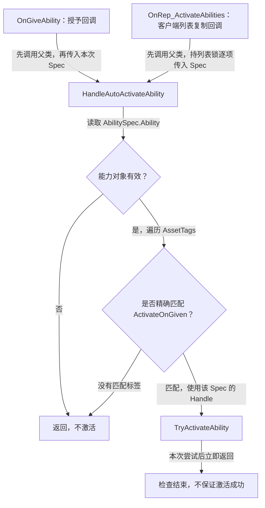
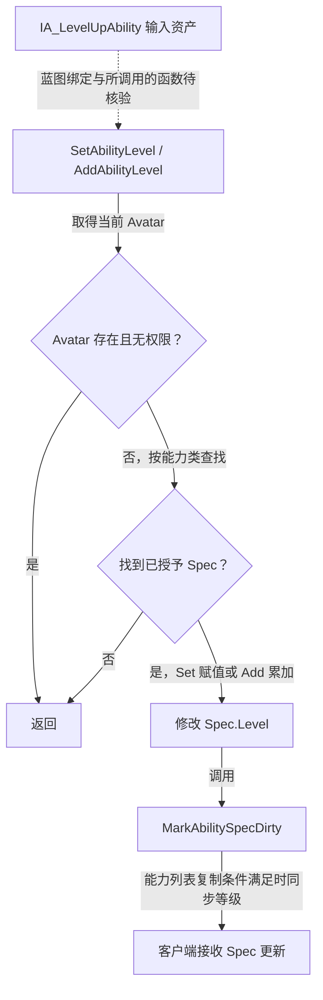

# UGAS_AbilitySystemComponent

继承 `UAbilitySystemComponent`，供玩家和敌人共用，负责在能力授予和能力列表复制回调中检查自动激活标签，并提供修改已授予能力等级的蓝图函数。

源码：`Source/GAS_Learning/AbilitySystem/GAS_AbilitySystemComponent.h`、`GAS_AbilitySystemComponent.cpp`。核对日期：2026-11-16。

## 头文件：函数声明

类标记为 `UCLASS(ClassGroup=(Custom), meta=(BlueprintSpawnableComponent))`，没有自定义成员变量。

| 可见性 | 函数 | 作用 |
| --- | --- | --- |
| public override | `OnGiveAbility(FGameplayAbilitySpec&)` | 先执行父类授予回调，再检查本次 Spec |
| public override | `OnRep_ActivateAbilities()` | 先执行父类复制回调，再遍历本端可激活能力列表 |
| public BlueprintCallable | `SetAbilityLevel(TSubclassOf<UGameplayAbility>, int32)` | 将已授予的 Spec 等级设为指定值 |
| public BlueprintCallable | `AddAbilityLevel(TSubclassOf<UGameplayAbility>, int32 = 1)` | 在 Spec 当前等级上加指定增量 |
| private | `HandleAutoActivateAbility(const FGameplayAbilitySpec&)` | 根据能力 AssetTags 判断是否尝试激活 |

## OnGiveAbility：本次授予的能力

摘自 `GAS_AbilitySystemComponent.cpp`，保留完整函数，省略空行：

```cpp
void UGAS_AbilitySystemComponent::OnGiveAbility(FGameplayAbilitySpec& AbilitySpec)
{
    Super::OnGiveAbility(AbilitySpec);
    HandleAutoActivateAbility(AbilitySpec);
}
```

启动能力的来源是 [AGAS_BaseCharacters](../Characters/CharacterBase.md) 的 `GiveStartupAbilities()`；组件在授予回调中检查这个 Spec。

## OnRep_ActivateAbilities：复制到本端的能力列表

摘自同一 `.cpp`，保留完整函数，省略空行：

```cpp
void UGAS_AbilitySystemComponent::OnRep_ActivateAbilities()
{
    Super::OnRep_ActivateAbilities();
    FScopedAbilityListLock ActiveScopeLock(*this);
    for (const FGameplayAbilitySpec& AbilitySpec : GetActivatableAbilities())
    {
        HandleAutoActivateAbility(AbilitySpec);
    }
}
```

能力列表复制到客户端后，回调在作用域列表锁内遍历 `GetActivatableAbilities()`。每次回调都会重新检查所有条目。组件没有记录哪些能力已经自动激活过。

## HandleAutoActivateAbility：精确匹配并尝试激活

函数先将 `AbilitySpec.Ability` 保存为 `const UGameplayAbility* CurAbility`，为空则返回。以下摘自同一 `.cpp`，仅保留遍历标签的部分：

```cpp
for (const FGameplayTag& Tag : CurAbility->GetAssetTags())
{
    if (Tag.MatchesTagExact(GAS_Tags::Abilities::ActivateOnGiven))
    {
        TryActivateAbility(AbilitySpec.Handle);
        return;
    }
}
```

`MatchesTagExact()` 要求完整匹配 `GAS_Tags.Abilities.ActivateOnGiven`。找到后使用当前 Spec 的 Handle 调用 `TryActivateAbility()` 并立即返回，不检查返回值，也没有失败重试队列。



两个入口不表示固定的跨端时序。函数没有自行检查 `HasAuthority()`；实际执行端和成功条件还受引擎能力生命周期、ActorInfo 就绪情况、能力网络策略及激活条件约束。

## SetAbilityLevel 与 AddAbilityLevel

两个函数都从 `GetAvatarActor()` 取得 Avatar。Avatar 存在且没有权限时提前返回。Avatar 为空时会继续查找 Spec，因此代码中的条件是针对现有 Avatar 的权限检查。找到指定类的 Spec 后，`SetAbilityLevel()` 直接赋值，`AddAbilityLevel()` 先加上参数值，再标记 Spec 已修改。增量默认值为 1，两条路径均直接使用传入整数。

以下摘自 `GAS_AbilitySystemComponent.cpp` 的 `AddAbilityLevel()`，保留函数体并省略空行。

```cpp
const AActor* CurAvatarActor = GetAvatarActor();
if (CurAvatarActor && !CurAvatarActor->HasAuthority()) return;
if (FGameplayAbilitySpec* AbilitySpec = FindAbilitySpecFromClass(AbilityClass))
{
    AbilitySpec->Level += Level;
    MarkAbilitySpecDirty(*AbilitySpec);
}
```



这两个函数直接修改 Spec 记录。升级输入资源已存在，连接位置和客户端发起升级时的转发方式仍需在蓝图中核验。

## 类间职责

| 职责 | 所属类 |
| --- | --- |
| 创建组件并设置 Mixed | [AGAS_PlayerState](../Player/PlayerState.md) |
| 创建组件并设置 Minimal | [AGAS_EnemyCharacter](../Characters/EnemyCharacter.md) |
| 属性集定义、属性访问器与复制通知 | [UGAS_AttributeSet](AttributeSet.md) |
| 本端 ASC / 属性集引用广播、初始 GE 应用 | [AGAS_BaseCharacters](../Characters/CharacterBase.md) 及两个角色调用点 |
| 初始化 OwnerActor / AvatarActor | [AGAS_PlayerCharacter](../Characters/PlayerCharacter.md)、AGAS_EnemyCharacter |
| 保存能力类数组、构造 Spec、调用 GiveAbility | AGAS_BaseCharacters |
| 输入 Tag 检索激活 | [AGAS_PlayerController](../Player/PlayerController.md) |
| 按自动激活标签检查 Spec | 本类 |

持有者的成员类型为 `TObjectPtr<UAbilitySystemComponent>`，getter 返回 `UAbilitySystemComponent*`；实际对象为本类，通过基类接口仍会进入重写的回调。

授予回调可能在角色 `InitializeAttributes()` 之前尝试激活。ActorInfo 已初始化不等于初始 GE 已应用；该顺序详见 [角色基类](../Characters/CharacterBase.md) 和 [初始化关系索引](StartupAbilities.md)。
