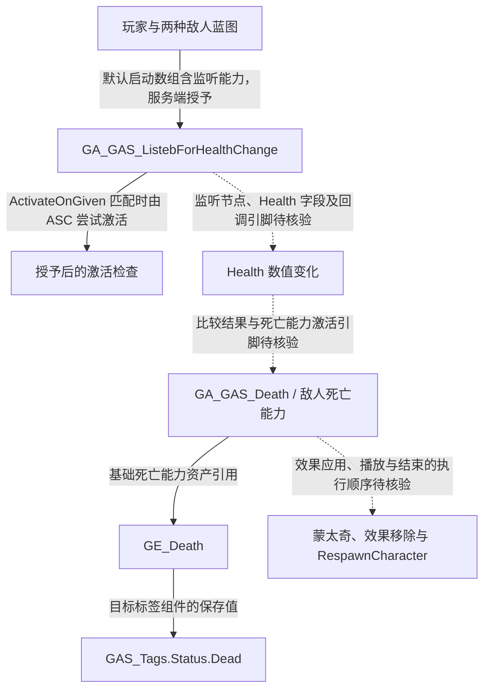

# 死亡与生命值监听蓝图

能力蓝图位于 `/Game/GAS_Learning/Blueprints/AbilitySystem/Abilities`，效果资产位于同级 GameplayEffects 目录。以下设置来自资产注册信息、类默认对象和事件图节点的序列化数据。

| 资产 | 已保存的父类与默认值 |
| --- | --- |
| GA_GAS_ListebForHealthChange | UGAS_GameplayAbility，AssetTags 含 GAS_Tags.Abilities.ActivateOnGiven，Instanced Per Actor，Server Initiated，bDrawDebugs 开启 |
| GA_GAS_Death | UGAS_GameplayAbility，AssetTags 含 GAS_Tags.Abilities.Death，Instanced Per Actor，bDrawDebugs 开启 |
| EnemyAbilities/Melee/GA_GAS_Death_Melee | DeathMontage 为 AM_Death_Melee |
| EnemyAbilities/Ranged/GA_GAS_Death_Ranged | DeathMontage 为 AM_Death_Ranged |
| GameplayEffects/GE_Death | Duration Policy 为 Infinite，Stack Limit Count 为 1，目标标签组件配置 GAS_Tags.Status.Dead |

`GA_GAS_ListebForHealthChange` 保留资产文件中的实际拼写。事件图保存了 `K2_ActivateAbility`、`ListenForAttributeChange`、数值小于等于比较、`TryActivateAbilitiesByTag`、`K2_OnEndAbility` 与 `EndTask` 节点。资产数据也包含 `UGAS_AttributeSet.Health` 字段引用。比较阈值、Tag 引脚及结束回调的连线待核验。

`GA_GAS_Death` 保存 `GE_Death` 资产引用，并有 `MakeOutgoingSpec`、`BP_ApplyGameplayEffectSpecToSelf`、蒙太奇任务、`BP_RemoveGameplayEffectFromOwnerWithGrantedTags` 与名为 `RespawnCharacter` 的节点。图中还保存了 `K2_HasAuthority`、`K2_FindPlayerStart`、`K2_SetActorLocation`、`ResetAttributes` 和 `HandleRespawn` 节点。敌人基蓝图引用 `GE_ResetAttributes`，其中 Mana 覆盖为 99，其余三项为 100。玩家蓝图默认对象未保存 `ResetAttributesEffect` 字段。复活入口的执行顺序、各分支的调用端及玩家是否触发重置仍待核验。参见 [属性效果设置](GameplayEffects.md)。

角色的 C++ 生命值回调和蓝图监听代理各自通过 ASC 接收属性变化。参见 [角色基类](../Characters/CharacterBase.md) 和 [属性监听代理](../Tasks/AttributeChangeTask.md)。
