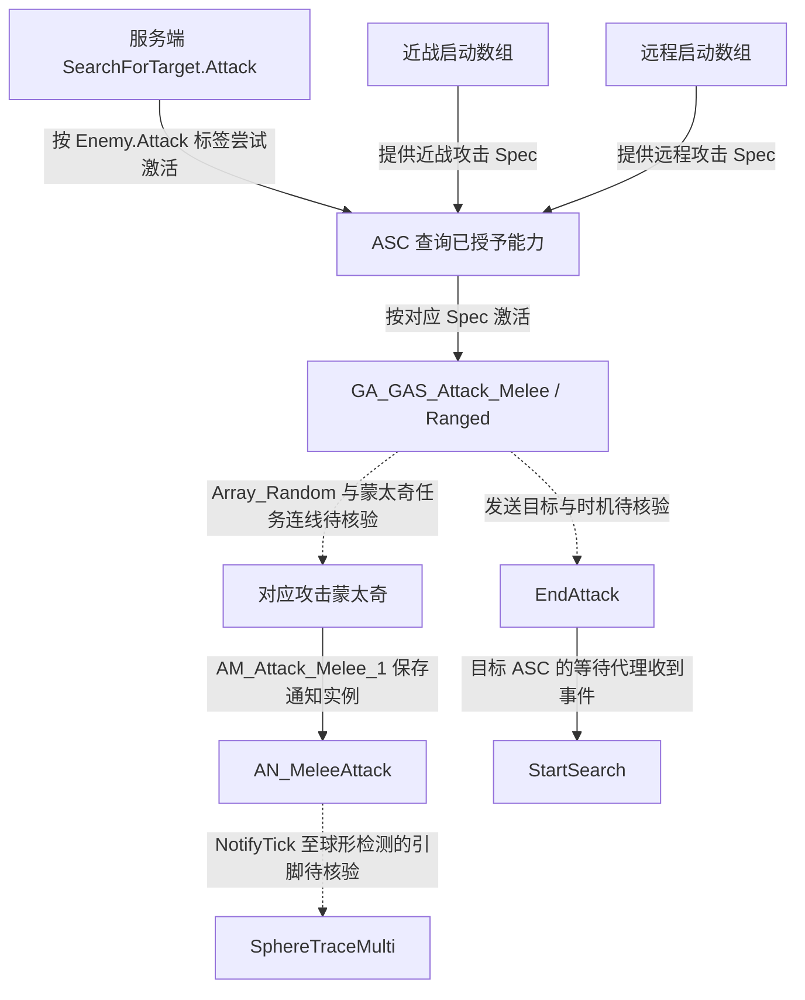

# 敌人攻击蓝图与近战通知

资产以 `/Game/GAS_Learning/Blueprints` 为根。近战与远程攻击能力的父类均为 `UGAS_GameplayAbility`，AssetTags 均保存 `GAS_Tags.Abilities.Enemy.Attack`，实例策略为 Instanced Per Actor，网络执行策略为 Server Only。

## 攻击能力

| 资产 | 已核验的节点或配置 |
| --- | --- |
| AbilitySystem/Abilities/EnemyAbilities/Melee/GA_GAS_Attack_Melee | Array_Random、蒙太奇任务、SendGameplayEventToActor、K2_EndAbility、K2_OnEndAbility |
| AbilitySystem/Abilities/EnemyAbilities/Ranged/GA_GAS_Attack_Ranged | Array_Random、蒙太奇任务、投射物生成节点、SendGameplayEventToActor、K2_EndAbility |
| Characters/Enemy/BP_Enemy_Melee | 启动数组包含 GA_GAS_Attack_Melee |
| Characters/Enemy/BP_Enemy_Ranged | 启动数组包含 GA_GAS_Attack_Ranged |

两项攻击资产均保存 EndAttack 标签。随机蒙太奇数组、事件目标与结束分支的引脚连线待核验。

## AN_MeleeAttack

`Notifies/AN_MeleeAttack` 继承 `UAnimNotifyState`。保存的默认 Socket 为 `FX_Trail_01_R`，球形检测半径为 60。函数图包括 `Received_NotifyTick` 与 `BP_PerformSphereTrace`，含 `GetOwner`、`GetSocketTransform`、`GetForwardVector`、`SphereTraceMulti` 及向量运算节点。

已核对 `Characters/Enemy/Anim/Melee/AM_Attack_Melee_1` 包含该通知实例。通知窗口、检测起终点、忽略列表、命中去重和伤害应用连线待核验。

两类敌人的动画资产分别位于 `Characters/Enemy/Anim/Melee` 和 `Characters/Enemy/Anim/Ranged`。参见 [索敌能力](SearchForTarget.md)、[敌人角色](../Characters/EnemyCharacter.md) 和 [投射物](../GameObjects/Projectile.md)。
