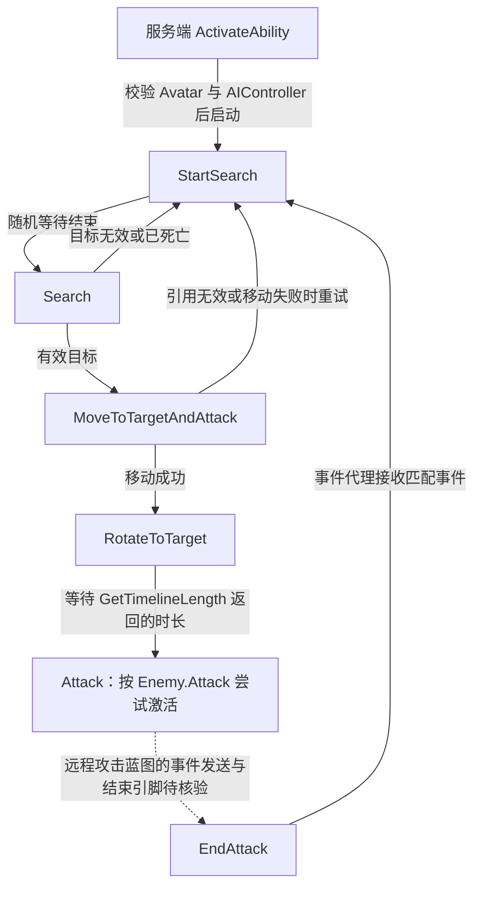

# UGAS_SearchForTarget

继承 `UGAS_GameplayAbility`。源码为 `Source/GAS_Learning/AbilitySystem/Abilities/Enemy/GAS_SearchForTarget.h` 与同名 `.cpp`。构造函数将实例策略设为 Instanced Per Actor，能力只在服务端执行（Server Only）。

| 声明 | 用途 |
| --- | --- |
| OwningEnemy、OwningAIController、TargetBaseCharacter | 弱引用，分别记录敌人、AIController 和选中的角色 |
| WaitGameplayEventTask | 保存 EndAttack 事件代理 |
| SearchDelayTask、AttackDelayTask | 分别等待索敌间隔和转向时长 |
| MoveToLocationOrActorTask | 保存移动任务并监听移动结果 |

`ActivateAbility()` 调用父类，对敌人 Avatar 和 AIController 转型并用 `check` 校验，然后开始索敌并绑定 EndAttack。`StartSearch()` 在 MinAttackDelay 与 MaxAttackDelay 间随机取值。延时完成后，`Search()` 按玩家 Actor Tag 及距离查找存活目标。

摘自 `GAS_SearchForTarget.cpp` 的 `ActivateAbility()`，保留事件代理绑定部分及前一行调用。

```cpp
StartSearch();

WaitGameplayEventTask = UGAS_WaitGameplayEvent::WaitGameplayEventToActorProxy(
    GetAvatarActorFromActorInfo(),GAS_Tags::Events::Enemy::EndAttack);
WaitGameplayEventTask->EventReceived.AddDynamic(this,&ThisClass::EndAttackEventReceived);
WaitGameplayEventTask->StartActivation();
```

`Search()` 先按 Actor Tag 与距离选一个最近对象，再检查其类型与 `IsAlive()`。若最近对象死亡，本次搜索回到延时，距离查询本身未过滤存活状态，因而可能反复选到同一个对象。

`MoveToTargetAndAttack()` 检查敌人存活、控制器与目标引用，用 `AcceptanceRadius` 创建 `UAITask_MoveTo`，绑定 `OnMoveTaskFinished`，再调用 `ConditionalPerformMove()`。`AttackTarget()` 只按路径结果分支。成功后调用蓝图转向，以 `GetTimelineLength()` 的返回值为延时。延时结束后由 `Attack()` 按 Enemy.Attack 尝试激活。

`EndAttackEventReceived()` 收到事件便重新开始索敌，当前回调未使用 Payload。`Attack()` 未根据激活返回值安排重试。近战与远程启动数组分别包含同标签的攻击能力，EndAttack 的发送时机与目标仍待核验。



## 蓝图设置

资产位于 `/Game/GAS_Learning/Blueprints/AbilitySystem/Abilities/EnemyAbilities`。`GA_GAS_SearchForTarget` 继承该 C++ 类，AssetTags 保存 ActivateOnGiven，近战和远程敌人的启动数组均引用它。

`Ranged/GA_GAS_Attack_Ranged` 继承 `UGAS_GameplayAbility`，AssetTags 为 Enemy.Attack，实例策略为 Instanced Per Actor，网络执行策略为 Server Only。资产引用 Ranged 动画目录的攻击蒙太奇，并保存 `Array_Random` 节点。具体随机数组与播放输入连线待核验。攻击图保存 `K2_ActivateAbility`、蒙太奇任务、`GetAvatarActorFromActorInfo`、`SendGameplayEventToActor`、`K2_EndAbility` 节点和 EndAttack 标签。发送目标、事件时机及引脚连接待编辑器核验。

参见 [敌人角色](../Characters/EnemyCharacter.md)、[最近目标查询](../Utils/BlueprintLibrary.md) 和 [事件等待代理](WaitGameplayEvent.md)。

## 远程投射物生成节点

`Ranged/GA_GAS_Attack_Ranged` 的资产保存了 `BP_GAS_Projectile` 类引用、`K2Node_SpawnActorFromClass` 节点及 Damage 引脚。图中还保存 `K2_HasAuthority`、`GetOwningComponentFromActorInfo`、`GetSocketTransform`、`GetForwardVector` 与 `MakeRotFromX` 节点。生成时机、Socket、Owner 和 Instigator 连线待核验。重叠处理及伤害配置见 [投射物类](../GameObjects/Projectile.md)。

近战蓝图设置和通知检测见 [敌人攻击蓝图](EnemyAttackBlueprints.md)。
