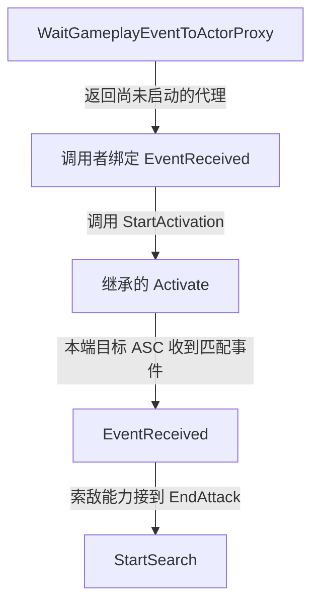

# UGAS_WaitGameplayEvent

继承 `UAbilityAsync_WaitGameplayEvent`。源码为 `Source/GAS_Learning/AbilitySystem/AbilityTasks/GAS_WaitGameplayEvent.h` 与同名 `.cpp`。

| 函数 | 行为 |
| --- | --- |
| WaitGameplayEventToActorProxy | 创建代理，保存目标 Actor、标签和监听选项。默认持续监听，且要求精确匹配 |
| StartActivation | 调用继承的 Activate，供 C++ 在绑定 EventReceived 之后启动 |

工厂标记为 BlueprintCallable、BlueprintInternalUseOnly，并将 TargetActor 设为 DefaultToSelf。摘自 `GAS_WaitGameplayEvent.cpp` 工厂函数体，保留全部语句。

```cpp
UGAS_WaitGameplayEvent* MyObj = NewObject<UGAS_WaitGameplayEvent>();
MyObj->SetAbilityActor(TargetActor);
MyObj->Tag = EventTag;
MyObj->OnlyTriggerOnce = OnlyTriggerOnce;
MyObj->OnlyMatchExact = OnlyMatchExact;
return MyObj;
```



索敌调用在服务端，目标为敌人 Avatar。蓝图中同名的引擎等待节点与本类代理可通过各自的工厂引用区分。参见 [索敌能力](SearchForTarget.md)。
