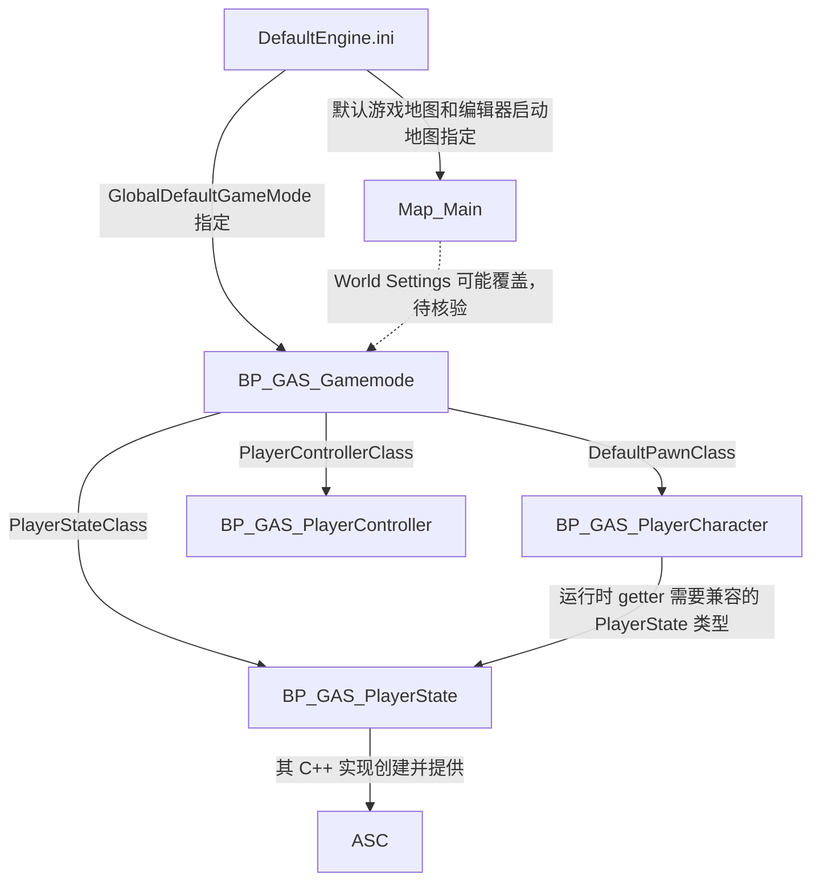
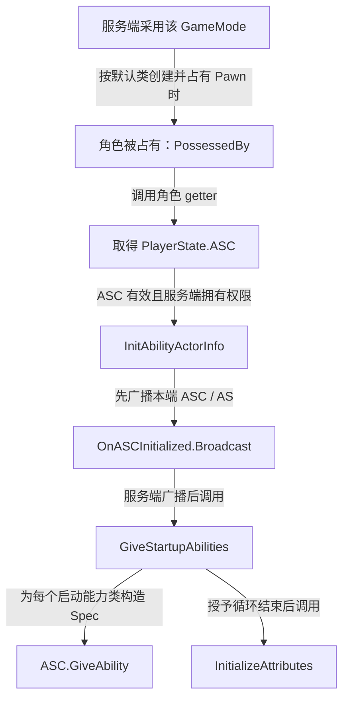

# BP_GAS_Gamemode：蓝图类与配置

GameMode 负责游戏规则和玩家对象的创建配置；联网游戏中的 GameMode 位于服务端。客户端需要使用的玩家状态，应通过 PlayerState 等可复制对象提供。

本项目的 GameMode 入口为蓝图资产，没有对应的自定义 GameMode `.h` / `.cpp`。资产注册信息中的父类为 `AGameModeBase`。

资产路径：

```text
Content/GAS_Learning/Blueprints/Game/BP_GAS_Gamemode.uasset
```

## 已确认的项目配置

`Config/DefaultEngine.ini` 的 `GameMapsSettings` 段指定：

```ini
GameDefaultMap=/Game/GAS_Learning/Maps/Map_Main.Map_Main
EditorStartupMap=/Game/GAS_Learning/Maps/Map_Main.Map_Main
GlobalDefaultGameMode=/Game/GAS_Learning/Blueprints/Game/BP_GAS_Gamemode.BP_GAS_Gamemode_C
```

即项目默认运行地图和编辑器启动地图都是 `Map_Main`，项目默认 GameMode 为 `BP_GAS_Gamemode`。具体地图的 World Settings 还可能覆盖 GameMode，运行时应检查该项；本次未核验地图内部设置。

## 蓝图类默认值

| GameMode 属性 | 已保存的类 | 职责 |
| --- | --- | --- |
| Default Pawn Class | `BP_GAS_PlayerCharacter` | 让实际生成的角色具有 ASC 访问与初始化逻辑 |
| Player Controller Class | `BP_GAS_PlayerController` | 使用项目的 Enhanced Input 和能力激活入口 |
| Player State Class | `BP_GAS_PlayerState` | 提供角色所需的 ASC 与属性集 |

三个字段均取自 `Default__BP_GAS_Gamemode_C` 的序列化属性。



实线表示已确认的配置或 C++ 依赖，虚线表示尚需在编辑器核验的配置关系。

当前参考项目模块为 `GAS_Learning`，上述 `/Game/GAS_Learning/...` 是仍在使用的实际资源路径。

## 与角色类函数的关系

GameMode 指定默认角色类，角色在自己的初始化回调中授予启动能力。



若 GameMode 选用了不兼容的 PlayerState，角色中的 `Cast<AGAS_PlayerState>` 会失败，后续初始化提前返回。排查技能无响应时，应先核对这些基础对象的实际类型。

参见：[项目配置](ProjectSetup.md)、[PlayerState](../Player/PlayerState.md)、[玩家角色](../Characters/PlayerCharacter.md)。
