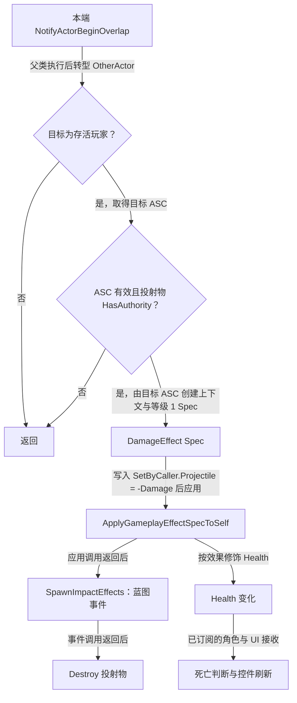
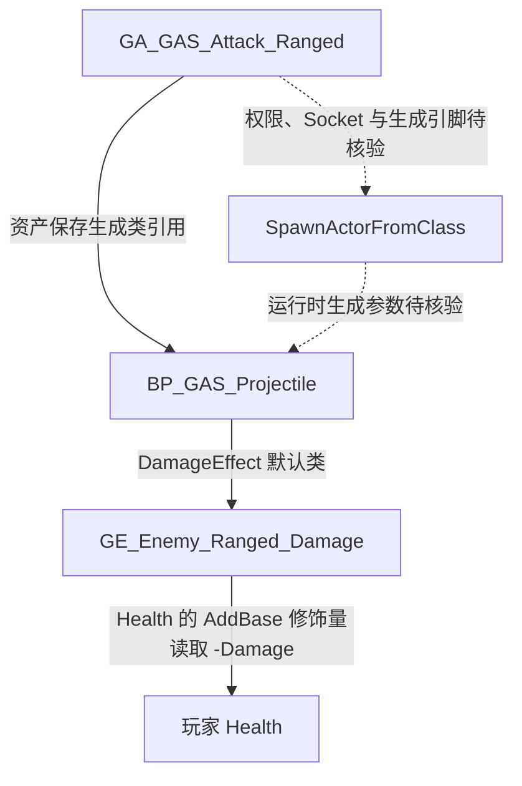

# AGAS_Projectile

继承 `AActor`，以静态网格作为根组件，使用 `UProjectileMovementComponent` 移动。源码为 `Source/GAS_Learning/GameObjects/GAS_Projectile.h` 与同名 `.cpp`。

## 成员与构造函数

| 声明 | 可见性与设置 | 职责 |
| --- | --- | --- |
| Damage | public，EditAnywhere、BlueprintReadOnly，ExposeOnSpawn，ClampMin 0.0，默认 25 | 暴露给生成节点的伤害参数 |
| SpawnImpactEffects() | public，BlueprintImplementableEvent | 服务端应用效果后调用的命中表现入口 |
| MeshComponent | private，VisibleAnywhere | 静态网格根组件 |
| ProjectileMovement | private，VisibleAnywhere | 投射物移动组件 |
| DamageEffect | private，EditDefaultsOnly | 应用于玩家的效果类 |
| NotifyActorBeginOverlap | public override | 重叠时检查目标、应用效果并销毁自身 |

构造函数关闭 Actor Tick，创建 Mesh 与 ProjectileMovement，并设置 `bReplicates = true`。初速度、生命周期、网格和伤害效果在蓝图中配置。

## NotifyActorBeginOverlap

函数先执行父类重叠回调，将 `OtherActor` 转为 `AGAS_PlayerCharacter`，要求玩家存活且具有 ASC，并检查投射物自身的 `HasAuthority()`。随后用目标玩家的 ASC 创建上下文和等级 1 的效果 Spec。

以下摘自 `GAS_Projectile.cpp` 的 `NotifyActorBeginOverlap()`，保留上下文创建至销毁部分，省略空行。

```cpp
FGameplayEffectContextHandle ContextHandle = AbilitySystemComponent->MakeEffectContext();
FGameplayEffectSpecHandle SpecHandle = AbilitySystemComponent->MakeOutgoingSpec(DamageEffect,1.f,ContextHandle);
UAbilitySystemBlueprintLibrary::AssignTagSetByCallerMagnitude(SpecHandle,GAS_Tags::SetByCaller::Projectile,-Damage);
AbilitySystemComponent->ApplyGameplayEffectSpecToSelf(*SpecHandle.Data.Get());
SpawnImpactEffects();
Destroy();
```

当前代码直接解引用 Spec 数据，效果类引用与 Spec 有效性依赖运行时配置。代码以 `GAS_Tags.SetByCaller.Projectile` 将 `-Damage` 写入 Spec。蓝图默认效果使用同名 Data Tag，未覆写 Damage 时本次修饰量为 -25。效果上下文由目标 ASC 创建，代码未显式写入射手的 Instigator，因此击杀归属应结合运行时上下文核验。



## BP_GAS_Projectile 的设置

资产路径为 `/Game/GAS_Learning/GameObjects/BP_GAS_Projectile`，保存的父类为 `AGAS_Projectile`。

| 字段 / 组件 | 已核验的保存值 |
| --- | --- |
| DamageEffect | GE_Enemy_Ranged_Damage |
| InitialLifeSpan | 10 秒 |
| ProjectileMovement.InitialSpeed | 3000 |
| Mesh.StaticMesh | GameObjects/Mesh/SM_Projectile |
| Mesh.BodyInstance.CollisionEnabled | QueryOnly |
| Mesh.BodyInstance.CollisionProfileName | OverlapAll |
| Mesh.BodyInstance.ObjectType | WorldStatic |

蓝图覆盖 `SpawnImpactEffects`，图中保存 `SpawnEmitterAtLocation`、`K2_GetComponentLocation` 与 `K2_GetComponentToWorld` 节点，并引用 `P_Dragon_Fireball_Projectile`。C++ 在服务端效果应用后调用该事件。表现是否通过其他节点转发至客户端，以及粒子参数连线待核验。

远程攻击能力保存投射物类引用及生成节点，也包含 `K2_HasAuthority`、`GetSocketTransform`、`GetForwardVector` 和 `MakeRotFromX` 节点。生成端、Socket 名、位置旋转、Owner、Instigator 和 Damage 引脚均待核验。



参见 [远程攻击](../AbilitySystem/SearchForTarget.md)、[属性效果](../AbilitySystem/GameplayEffects.md) 和 [属性集](../AbilitySystem/AttributeSet.md)。
