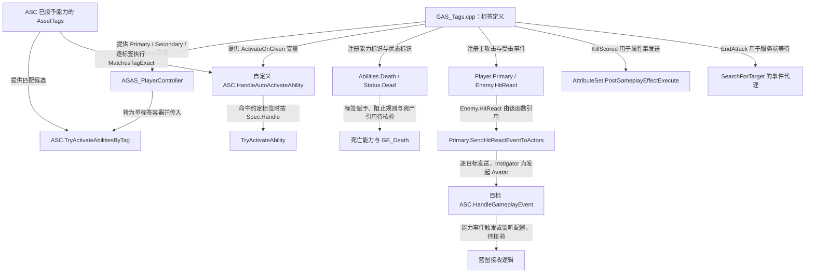

# GAS_Tags.h / GAS_Tags.cpp

这两个文件不定义 UObject 类。`GAS_Tags.h` 通过 `NativeGameplayTags.h` 声明原生标签变量，`GAS_Tags.cpp` 在相同命名空间内定义完整字符串。核对日期：2026-11-18。

源码目录：`Source/GAS_Learning/GameplayTags`。

## CharacterType 命名空间

`GAS_Tags::CharacterType::Player` 注册为 `GAS_Tags.CharacterType.Player`。玩家构造函数将名称写入 Actor Tags，服务端索敌通过名称匹配 Actor。参见 [最近目标查询](../Utils/BlueprintLibrary.md)。

## Abilities：能力标识与自动激活约定

| C++ 变量（前缀 GAS_Tags::） | 完整注册字符串 | 当前 C++ 消费位置 |
| --- | --- | --- |
| `Abilities::ActivateOnGiven` | `GAS_Tags.Abilities.ActivateOnGiven` | ASC.HandleAutoActivateAbility 精确匹配 |
| `Abilities::Death` | `GAS_Tags.Abilities.Death` | 已注册，死亡能力配置待核验 |
| `Abilities::Primary` | `GAS_Tags.Abilities.Primary` | PlayerController.Primary |
| `Abilities::Secondary` | `GAS_Tags.Abilities.Secondary` | PlayerController.Secondary |
| `Abilities::Tertiary` | `GAS_Tags.Abilities.Tertiary` | PlayerController.Tertiary |
| `Abilities::Enemy::Attack` | `GAS_Tags.Abilities.Enemy.Attack` | SearchForTarget.Attack 查询，远程攻击蓝图以此作为 Asset Tag |
| `Abilities::Enemy::HitReact` | `GAS_Tags.Abilities.Enemy.HitReact` | 已注册；自定义 C++ 没有直接引用该变量的调用 |

`ActivateOnGiven` 是 ASC 使用的约定，能力资产需在自身 AssetTags 中持有该标签才会匹配。其检查代码归入 [UGAS_AbilitySystemComponent](../AbilitySystem/AbilitySystemComponent.md)。

## Events：事件标识

| C++ 变量（前缀 GAS_Tags::） | 完整注册字符串 |
| --- | --- |
| `Events::KillScored` | `GAS_Tags.Events.KillScored` |
| `Events::Enemy::EndAttack` | `GAS_Tags.Events.Enemy.EndAttack` |
| `Events::Player::Primary` | `GAS_Tags.Events.Primary` |
| `Events::Enemy::HitReact` | `GAS_Tags.Events.Enemy.HitReact` |

摘自 `GAS_Tags.cpp`，仅保留外层 `GAS_Tags` 内部 `Events::Player` 的完整命名空间定义：

```cpp
namespace Player
{
    UE_DEFINE_GAMEPLAY_TAG_COMMENT(Primary, "GAS_Tags.Events.Primary", "Tag for the Player Primary Event");
}
```

C++ 命名空间含 `Player`，实际注册字符串不含 `.Player`。事件 Primary 与能力 Primary 是不同标签；Enemy.HitReact 的能力和事件字符串也不同。

`UGAS_Primary::SendHitReactEventToActors()` 直接使用 `Events::Enemy::HitReact`，为目标数组逐项发送受击事件，Payload.Instigator 为当前 Avatar。`Events::Player::Primary` 当前只有注册，没有对应的自定义 C++ 发送调用。目标能力的监听与触发配置仍需核验，见 [事件关系索引](../AbilitySystem/GameplayEvents.md)。

## Status 命名空间

`GAS_Tags::Status::Dead` 注册为 `GAS_Tags.Status.Dead`，用于标识死亡状态。它与能力标识 `GAS_Tags.Abilities.Death` 属于不同分支。角色基类直接写入的是 `bAlive`，死亡能力如何使用标签及效果资产需在编辑器核验。

## 声明与定义的对应方式

头文件使用 `UE_DECLARE_GAMEPLAY_TAG_EXTERN`，源文件使用 `UE_DEFINE_GAMEPLAY_TAG_COMMENT`，定义保持相同命名空间。以下摘自 `GAS_Tags.cpp` 的 `Abilities::Enemy` 命名空间，保留该命名空间定义：

```cpp
namespace Enemy
{
    UE_DEFINE_GAMEPLAY_TAG_COMMENT(Attack, "GAS_Tags.Abilities.Enemy.Attack", "Tag for the Enemy Attack Ability");
    UE_DEFINE_GAMEPLAY_TAG_COMMENT(HitReact, "GAS_Tags.Abilities.Enemy.HitReact", "Tag for the Enemy HitReact Ability");
}
```

C++ 中的 `::` 用于访问变量，字符串中的 `.` 表示标签层级。定义标签的文件只负责标识，行为由消费它的类承担。

## 标签与所属类的调用关系



UE 5.6 的输入检索路径使用 `Spec.Ability->GetAssetTags().HasAll(...)`；自动激活路径则逐标签执行 `MatchesTagExact()`。两条路径的入口和匹配方式不同。能力标识属性在本机引擎 `GameplayAbility.h` 的显示名为 `AssetTags (Default AbilityTags)`，不要与激活所需、激活阻止或激活附加标签混淆。

具体输入逻辑见 [AGAS_PlayerController](../Player/PlayerController.md)，能力实现见 [UGAS_Primary](../AbilitySystem/Primary.md) 和 [UGAS_HitReact](../AbilitySystem/HitReact.md)。

## SetByCaller 命名空间

`GAS_Tags::SetByCaller::Projectile` 注册字符串为 `GAS_Tags.SetByCaller.Projectile`。投射物用它写入 `-Damage`，`GE_Enemy_Ranged_Damage` 的 Health 修饰量以此为 Data Tag 读取数值。参见 [投射物](../GameObjects/Projectile.md)。
