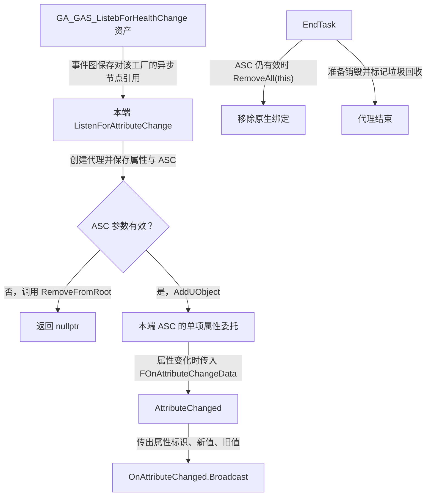

# UGAS_AttributeChangeTask

继承 `UBlueprintAsyncActionBase`，为蓝图提供单项属性变化的异步监听。源码文件名使用 `Attritube` 拼写，类名使用 `Attribute`。对应文件为 `Source/GAS_Learning/Tasks/GAS_AttritubeChangeTask.h` 与同名 `.cpp`。

## 公开成员与函数

| 声明 | 职责 |
| --- | --- |
| OnAttributeChanged | BlueprintAssignable 动态多播委托，按顺序传出 Attribute、NewValue、OldValue |
| ASC | TWeakObjectPtr<UAbilitySystemComponent>，保存监听来源 |
| AttributeToListenFor | FGameplayAttribute，保存订阅与解绑使用的属性标识 |
| ListenForAttributeChange | 静态蓝图工厂，创建代理并订阅 ASC 属性变化 |
| AttributeChanged | 原生委托回调，将变化数据转发至蓝图 |
| EndTask | 蓝图可调用，移除绑定并结束代理 |

类元数据 `ExposedAsyncProxy = AsyncTask` 暴露代理，供调用者保留并调用 `EndTask()`。工厂带 `BlueprintInternalUseOnly` 标记。

## 监听与结束

`ListenForAttributeChange()` 先用 `NewObject` 创建代理，写入 ASC 与属性。空 ASC 分支调用 `RemoveFromRoot()` 并返回空指针。ASC 有效时用 `AddUObject` 绑定 `AttributeChanged()`，然后返回代理。订阅只接收绑定之后的变化。工厂函数不会在绑定时广播当前值。有效分支的代理保活和结束时机需要结合实际蓝图核验。

以下摘自 `GAS_AttritubeChangeTask.cpp` 的完整 `EndTask()`，省略空行。

```cpp
void UGAS_AttributeChangeTask::EndTask()
{
    if (ASC.IsValid())
    {
        ASC->GetGameplayAttributeValueChangeDelegate(AttributeToListenFor).RemoveAll(this);
    }
    SetReadyToDestroy();
    MarkAsGarbage();
}
```

监听和广播发生在调用节点的本端。服务端属性修改与客户端数值复制都可能触发对应端 ASC 的属性变化委托。蓝图端处理哪一次通知取决于其节点执行位置及 ASC 实例。



控件组件与角色的本地监听分别直接绑定 ASC 委托。相关入口见 [控件组件](../UI/WidgetComponent.md) 和 [角色基类](../Characters/CharacterBase.md)。

监听能力蓝图同时保存了 `ListenForAttributeChange` 和 `EndTask` 节点。实际结束绑定与激活时序见 [死亡与监听蓝图](../AbilitySystem/DeathBlueprints.md)。
